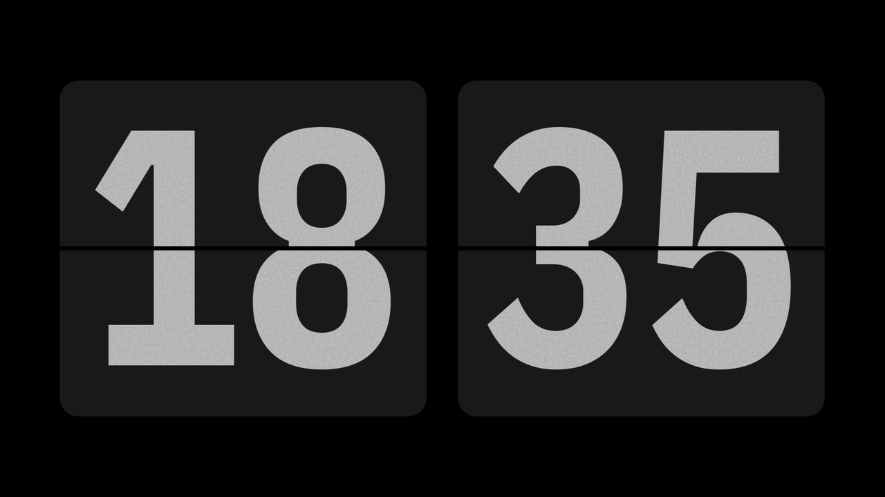

<p align="center">
  
</p>

<h1 align="center">Ribalta</h1>

<p align="center">
  <b>A tiny flip clock and study timer for Linux — ~18 MB of RAM, ~0% CPU when idle.</b>
</p>

<p align="center">
  <a href="https://github.com/Ginteaa/Ribalta/actions/workflows/build.yml"></a>
  <a href="https://github.com/Ginteaa/Ribalta/actions/workflows/flatpak.yml"></a>
  
  
  
  
  
</p>

<p align="center">
  
</p>

**Ribalta** is a lightweight flip clock for Linux (Wayland and X11), written in C17 with SDL3 and
SDL3_ttf. It shows the time on animated flip tiles and doubles as a study companion: a countdown
timer that keeps running in the background, a Pomodoro mode, study statistics and a screensaver
mode. Install it natively from source or as a **Flatpak**, which runs on any distribution
(including Ubuntu 24.04 and Linux Mint 22, which do not ship SDL3). An **experimental macOS build**
is also available.

The name is Italian: *ribalta* means "flip over" (as in a tile turning) and also "the stage"
(the limelight). The look is inspired by the classic flip-clock style, but the code and artwork are
original and the project is not affiliated with Fliqlo.

> The interface is currently in Italian (labels such as `TIMER`, `RIPOSO`, `IMPOSTAZIONI`,
> `STATISTICHE`).

## ✨ Features

- 🕰️ **Flip clock** `HH:MM`, with optional seconds and 12h/24h format; only the tiles that change flip
- ⏳ **Study timer** from 0h01 to 23h59, keeps running while you look at the clock; type the duration with the digit keys, microwave style (`1` `3` `0` → `01:30`)
- 🍅 **Pomodoro** with study, short break and long break phases (breaks turn the digits blue, or amber if you picked a blue colour)
- 🔤 **Digit font**: keep the bundled font or pick any installed font from a searchable drop-down menu with live preview
- 🎨 **Digit colour** with a built-in colour picker (palette, HEX field, recent colours, live preview); the accent applies to digits, progress bar and labels
- 📊 **Study statistics**: today, last 7 days, month, streak, completed sessions
- ⚙️ **Settings overlay** (`S`), changes apply live and are saved to a plain `config.ini`
- 🌙 **Screensaver mode** (`ribalta --screensaver`), easy to hook to `swayidle`
- 💡 **Keeps the screen awake** while a timer or Pomodoro is running (idle-inhibit)
- 🔔 **Desktop notification and chime** when a session or phase ends
- 🔒 **Single instance** and 🖥️ **HiDPI** support, resizable window, fullscreen
- 📦 **Two ways to install**: native build (`make install`) or Flatpak for any distribution

## 📸 Screenshots

| | |
|:---:|:---:|
| <br>**Clock**: fullscreen `HH:MM` | <br>**Study timer**: running, with progress bar |
| <br>**Pomodoro**: break phase in blue | <br>**Settings** overlay (`S`) |
| <br>**Statistics** overlay (`I`, sample data) | <br>**Colour picker**: live preview of the digit colour |

## 📦 Installation

There are two ways to install Ribalta; both are maintained and built by the CI:

| | Native (from source) | Flatpak |
|---|---|---|
| Works on | distributions that ship SDL3 ≥ 3.2 (Arch, Fedora, openSUSE Tumbleweed…) | any distribution with Flatpak, including Ubuntu 24.04 and Mint 22 |
| Memory at idle (PSS) | ~18 MB | ~25 MB (the runtime's libraries are not shared with the host) |
| Settings and statistics | `~/.config/ribalta/`, `~/.local/share/ribalta/` | `~/.var/app/io.github.ginteaa.Ribalta/` |

If your distribution ships SDL3, the native build is the lightest choice. The two installs can live
side by side; they keep separate settings and statistics.

### Install with Flatpak

The `org.freedesktop.Platform` 25.08 runtime provides fontconfig and `notify-send`; SDL3 3.4,
FreeType and SDL3_ttf are built into the package. Nothing else has to be installed. Ribalta is not on
Flathub yet.

1. On Ubuntu, Flatpak is not installed by default (Mint already has it):

```sh
sudo apt install flatpak
flatpak remote-add --user --if-not-exists flathub https://dl.flathub.org/repo/flathub.flatpakrepo
```

2. Open the latest successful run of the [**Flatpak** workflow](https://github.com/Ginteaa/Ribalta/actions/workflows/flatpak.yml)
   and download the `ribalta-x86_64.flatpak` artifact (you must be signed in to GitHub). It is a
   zip: extract `ribalta.flatpak` from it.
3. Install and run it (the `org.freedesktop.Platform` 25.08 runtime is fetched from Flathub):

```sh
flatpak install --user ribalta.flatpak
flatpak run io.github.ginteaa.Ribalta
```

To build the package locally:

```sh
flatpak install --user flathub org.freedesktop.Sdk//25.08
flatpak-builder --user --install --force-clean build-flatpak packaging/flatpak/io.github.ginteaa.Ribalta.yml
```

Inside the sandbox the configuration and the data live in `~/.var/app/io.github.ginteaa.Ribalta/`
(`config/ribalta/config.ini`, `data/ribalta/sessions.csv`). The system fonts are visible to the digit-font menu.

Packagers can use `make install-files PREFIX=... APPID=...`, which installs the files without
building (used by the Flatpak manifest).

### macOS (experimental)

The macOS port is new and tested only by the CI so far: feedback is welcome. Settings and statistics
live in `~/Library/Application Support/Ribalta/`. Notifications are shown through `osascript`, so
macOS lists them under *Script Editor*.

**Download.** The `macos` workflow builds `Ribalta-macos-arm64.zip` (Apple Silicon) and
`Ribalta-macos-x86_64.zip` (Intel), with SDL3 bundled; tagged releases have them attached. The app is
signed ad hoc but **not notarised** (that needs a paid Apple Developer account), so macOS blocks the
first launch:

1. Unzip and move `Ribalta.app` to *Applications*.
2. Open it once; when macOS refuses, go to *System Settings → Privacy & Security* and click
   **Open Anyway** (or run `xattr -dr com.apple.quarantine /Applications/Ribalta.app`).

**Build from source** (nothing to approve: a locally built app is not quarantined), with
[Homebrew](https://brew.sh) and the Xcode command-line tools:

```sh
brew install sdl3 sdl3_ttf pkg-config
git clone https://github.com/Ginteaa/Ribalta.git && cd Ribalta
make install    # builds build/Ribalta.app and copies it to ~/Applications
```

`make app` only builds `build/Ribalta.app`. Such a bundle links Homebrew's SDL3, so it runs on the Mac
that built it; `BUNDLE_LIBS=1 make app` (needs `brew install dylibbundler`) copies the libraries
inside, as the CI does.

### Install from source

**Dependencies**

- `sdl3` and `sdl3_ttf` (SDL3 ≥ 3.2 and SDL3_ttf ≥ 3.2; build and runtime)
- `fontconfig`: headers at build time; the library is loaded only when the digit-font menu opens
  (without it the menu lists just the bundled font)
- `libnotify` (optional): provides `notify-send` for desktop notifications

On Arch Linux:

```sh
sudo pacman -S sdl3 sdl3_ttf fontconfig libnotify
```

On other distributions install the equivalent SDL3 and SDL3_ttf development packages
(`pkg-config` must find `sdl3`, `sdl3-ttf` and `fontconfig`), plus a C compiler and `make`.

**Build and install**

```sh
git clone https://github.com/Ginteaa/Ribalta.git && cd Ribalta
make            # development build
make release    # optimised build (LTO, stripped)
make install    # installs to ~/.local (runs a release build first)
```

`make install` builds, then copies the binary to `~/.local/bin/ribalta`, the launcher to
`~/.local/share/applications/ribalta.desktop`, the icons to `~/.local/share/icons/hicolor` and the
assets (font, licence, chime) to `~/.local/share/ribalta`. In a terminal it shows a banner and a
progress bar; in logs or pipes it prints plain lines, like this:

```text
Checking requirements
✓ C compiler (cc)
✓ make
✓ pkg-config
✓ SDL3
✓ SDL3_ttf
✓ fontconfig

[1/5] Building...
✓ Building
[2/5] Installing binary...
✓ Installing binary
[3/5] Installing assets...
✓ Installing assets
[4/5] Installing icons...
✓ Installing icons
[5/5] Desktop entry and icon cache...
✓ Desktop entry and icon cache
```

Use `make V=1` for the full compiler commands during a normal build. Use
`PREFIX=/usr make install` (as root) for a system-wide install. `make uninstall` (with the same
`PREFIX`) removes only the installed files: **your settings and statistics are kept**. Make sure
`~/.local/bin` is in your `PATH`.

## ⌨️ Keyboard shortcuts

| Key | Action |
|---|---|
| `F` / `F11` / double click | Toggle fullscreen |
| `T` | Toggle Clock / Timer view (a running timer continues in the background) |
| `P` | Toggle Clock / Pomodoro view (`T` and `P` also switch directly between the two) |
| `Space` / `Enter` | Timer or Pomodoro: start / pause / resume |
| `0`–`9` / keypad | Timer in setup: type the duration, digits enter from the right (`1` `3` `0` → `01:30`, `90` → 1h30); `Enter`/`Space` confirms and starts, arrows / `T` / `P` / `S` / `I` confirm without starting |
| `Backspace` | Timer entry: delete the last digit |
| `R` | Timer: reset to the set duration. Pomodoro: reset everything |
| `N` | Pomodoro: skip to the next phase |
| `I` | Open / close the statistics panel |
| `← →` / `↑ ↓` | Timer in setup: select hours or minutes / adjust them (hours ±1, minutes ±1, `Shift` = ±10 min). Panels: navigate and change values |
| `S` | Open / close the settings panel |
| `Esc` | Cancel timer entry (keeps the previous duration); close the panel, the colour picker or the font menu; otherwise leave fullscreen |
| `Q` / `Ctrl+Q` | Quit |

`ribalta --help` lists the command-line options.

## ⚙️ Configuration

Settings live in `~/.config/ribalta/config.ini` (honours `$XDG_CONFIG_HOME`), in `key=value`
format; unknown keys are ignored and invalid values fall back to the default. You normally never
edit it by hand: the settings panel (`S`) changes everything live and saves on close.

| Key | Default | Description |
|---|---|---|
| `show_seconds` | `false` | Show seconds |
| `clock_24h` | `true` | 24h format (`false` = 12h with AM/PM) |
| `timer_default_minutes` | `60` | Proposed timer duration (1–1439) |
| `timer_sound` | `true` | Play a chime when the timer ends |
| `timer_notify` | `true` | Desktop notification when the timer ends |
| `scale` | `90` | Tile width in % of the window (50–100) |
| `brightness` | `100` | Digit brightness (20–100), handy at night |
| `start_fullscreen` | `false` | Start fullscreen |
| `animations` | `true` | Flip animation |
| `pomodoro_work` | `25` | Study minutes (1–180) |
| `pomodoro_break` | `5` | Short break minutes (1–60) |
| `pomodoro_long_break` | `15` | Long break minutes (1–120) |
| `pomodoro_cycles` | `4` | Study sessions before the long break (1–12) |
| `pomodoro_auto_continue` | `true` | Start the next phase automatically |
| `digit_color` | `#b7b7b7` | Digit colour `#rrggbb`; also tints the progress bar and labels (accent) |
| `recent_colors` | empty | Up to 5 recently used colours, comma separated (`#rrggbb,#rrggbb`) |
| `font_family` | empty | Name of the digit font (e.g. `DejaVu Sans`); empty = bundled font |
| `font_file` | empty | Path of the digit font file; empty = bundled font. The value runs to the end of the line (spaces allowed) |

The **Digit colour** row of the settings panel shows a swatch and the HEX code: `←`/`→` step through
the palette, `Enter` opens the colour picker (saturation/value square, hue bar, HEX field, palette
grid, recent colours; mouse or keyboard: `Tab` changes zone, `Enter` applies, `Esc` cancels). The
digits preview the colour live. During Pomodoro breaks the digits are blue (`#6fa8dc`), or amber
(`#ffb347`) if the chosen colour is already blue; the accent stays your colour.

The **Digit font** row (right after the colour) shows the font name: `←`/`→` switch to the previous or
next installed font, `Enter` opens the font menu: type to filter, `↑`/`↓`/`PgUp`/`PgDn`/`Home`/`End`
or the mouse wheel to move, click to select, `Enter` (or double click) applies and saves, `Esc` clears
the filter, then restores the previous font. The tiles preview the selected font after a short pause.
At startup the saved `font_file` is opened directly (no font lookup); if the file is missing Ribalta
prints a warning on stderr and uses the bundled font, leaving the setting untouched.

## 🍅 Pomodoro

`P` opens the Pomodoro view: STUDIO (25 min) → RIPOSO (5 min) → … and, after 4 study sessions, a
RIPOSO LUNGO (15 min), then the cycle restarts. `Space`/`Enter` starts or pauses, `N` skips to
the next phase, `R` resets. During breaks the digits turn blue. At the end of each phase you get a
notification and a chime, and with `pomodoro_auto_continue=true` the next phase starts by itself.
The timer and the Pomodoro are independent and can both run in the background.

## 📊 Statistics

Study sessions (timer sessions and Pomodoro study phases, never breaks, and only if at least 60 s
were studied) are appended to `~/.local/share/ribalta/sessions.csv` (honours `$XDG_DATA_HOME`),
one row per session:

```csv
inizio,durata_s,tipo,completata
2026-11-14T09:30:00,1500,pomodoro,1
```

The columns are the local start time (ISO 8601), the studied seconds (pauses excluded), the type
(`timer` or `pomodoro`) and whether the session ran to completion (`1`) or was stopped early (`0`).
Press `I` to see today, the last 7 days, the month, your streak of consecutive days and the number
of completed sessions. The file is read only when the panel opens.

## 🌙 Screensaver

```sh
ribalta --screensaver
```

Fullscreen with a hidden cursor; any key, click or mouse movement exits (events in the first second
are ignored). It saves nothing, and if Ribalta is already running the screensaver instance exits
immediately. To start it after 5 minutes of inactivity, for example with niri
(`~/.config/niri/config.kdl`):

```kdl
spawn-at-startup "swayidle" "-w" "timeout" "300" "ribalta --screensaver"
```

or from any compositor/session script:

```sh
swayidle -w timeout 300 'ribalta --screensaver'
```

## ⚡ Performance

Measured on Wayland (niri) with the default `gpu` renderer and the window visible:

| Metric | Value |
|---|---|
| Memory (PSS) at idle | ~17–19 MB native, ~25 MB Flatpak |
| CPU, `HH:MM` clock (one flip per minute) | ~40 ms per minute (~0.07%) |
| CPU while seconds are visible | ~2.2% |
| CPU when the window is not in view | ~0.15%, even with seconds |
| Flip animation | 30 fps, 400 ms |
| Release binary size | ~60 KB |

Tips for the absolute minimum: set `show_seconds=false` and/or `animations=false`. The renderer
is tried in the order `gpu, opengl, opengles2, software`; override it with
`SDL_RENDER_DRIVER=<name> ribalta` (the OpenGL renderer uses noticeably more memory).

## 🛠️ How it works

- **Event-driven loop**: when nothing animates, the process sleeps in `SDL_WaitEventTimeout` until
  the next minute (or second) boundary or an input event. No fixed-rate polling.
- **Pre-rendered glyph textures**: digits and tiles are rasterised once with SDL3_ttf (and again
  only on resize); a flip just composites rectangles already on the GPU.
- **Faces re-rendered only on change**: a frame is drawn only when a value changes, an animation
  runs or a panel opens.
- **Monotonic timer**: timers store their end instant from a monotonic clock, so system time
  changes and NTP adjustments do not affect them.
- **Load on demand**: the overlay font, the audio and fontconfig are loaded only when needed (for
  example while a panel is open, a chime plays or the font menu lists the system fonts), and
  notifications use `notify-send` instead of linking libnotify.

## 📚 Documentation

The design documents live in [`docs/`](docs/README.md):

- [Functional specification](docs/01-functional-spec.md): modes, settings, controls, requirements
- [Visual design](docs/02-visual-design.md): palette, geometry, flip animation, mockups
- [Architecture](docs/03-architecture.md): stack, performance strategy, modules, development workflow
- [Roadmap](docs/04-roadmap.md): development phases and future ideas

## 🙏 Credits

- **IBM Plex Sans Condensed** font, licensed under the SIL Open Font License 1.1
  (see [`assets/OFL.txt`](assets/OFL.txt))
- [SDL3](https://libsdl.org) and SDL3_ttf for windowing, rendering, input and audio;
  [FreeType](https://freetype.org) and [fontconfig](https://www.freedesktop.org/wiki/Software/fontconfig/) for fonts
- The chime sound (`assets/ding.wav`) was generated for this project

## 📄 License

Copyright © 2026 Samuele

Ribalta is free software: you can redistribute it and/or modify it under the terms of the
**GNU General Public License** as published by the Free Software Foundation, either version 3 of
the License, or (at your option) any later version. It is distributed in the hope that it will be
useful, but WITHOUT ANY WARRANTY. See [`LICENSE`](LICENSE) for the full text
(SPDX: `GPL-3.0-or-later`).

The bundled IBM Plex Sans Condensed font keeps its own license, the SIL Open Font License 1.1
([`assets/OFL.txt`](assets/OFL.txt)).
