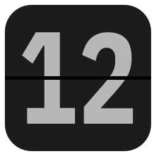
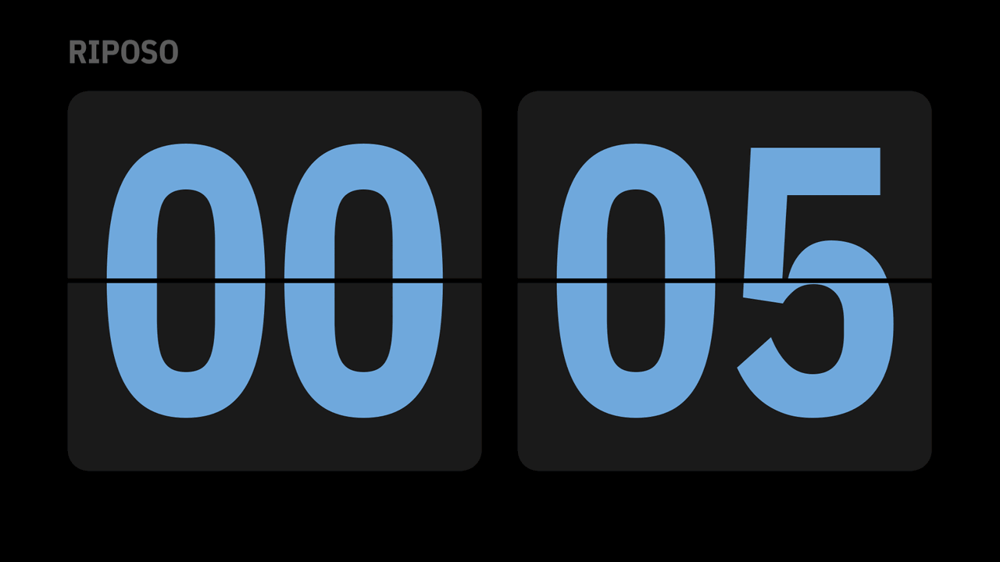
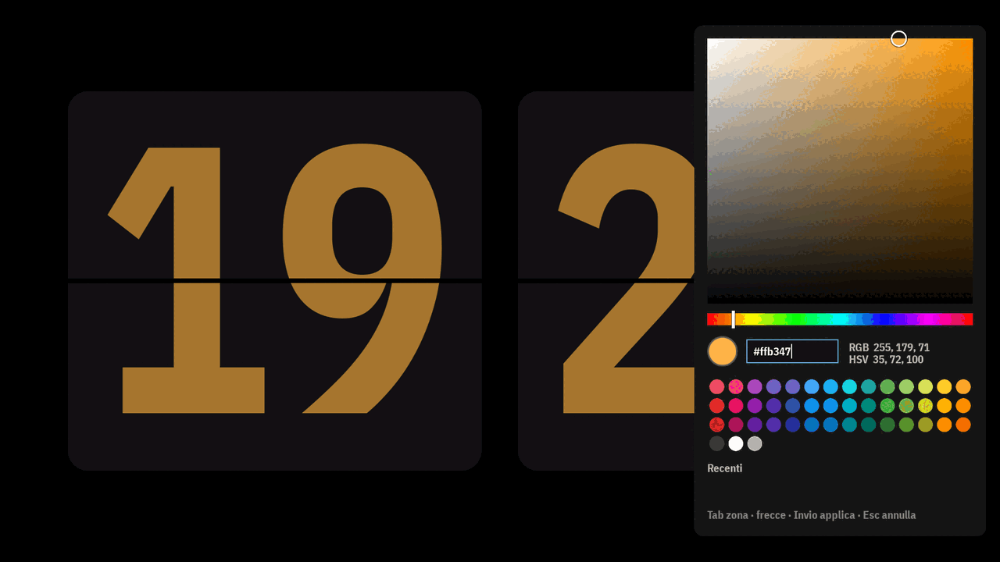
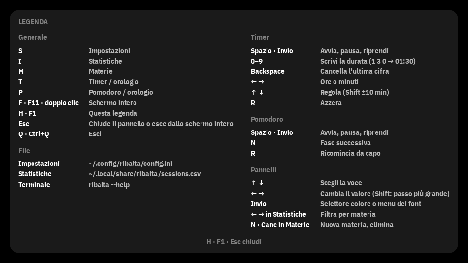

<p align="center">
  
</p>

<h1 align="center">Ribalta</h1>

<p align="center">
  <b>A tiny flip clock and study timer for Linux — ~18 MB of RAM, ~0% CPU when idle.</b>
</p>

<p align="center">
  <a href="https://github.com/Ginteaa/Ribalta/actions/workflows/build.yml"></a>
  <a href="https://github.com/Ginteaa/Ribalta/actions/workflows/flatpak.yml"></a>
  
  
  
  
  
</p>

<p align="center">
  
</p>

**Ribalta** is a lightweight flip clock for Linux (Wayland and X11), written in C17 with SDL3. It
shows the time on animated flip tiles and doubles as a study companion: a countdown timer that keeps
running in the background, a Pomodoro mode, study statistics and a screensaver. Install it natively
from source or as a **Flatpak**, which runs on any distribution (including Ubuntu 24.04 and Linux
Mint 22, which do not ship SDL3). An **experimental macOS build** is also available.

The name is Italian: *ribalta* means both "flip over" and "the stage" (the limelight). The look is
inspired by the classic flip-clock style, but code and artwork are original and the project is not
affiliated with Fliqlo. The interface is currently in Italian (`TIMER`, `RIPOSO`, `IMPOSTAZIONI`…).

## ✨ Features

- 🕰️ **Flip clock** `HH:MM`, optional seconds, 12h/24h; only the tiles that change flip
- ⏳ **Study timer** from 0h01 to 23h59, kept running in the background; type the duration with the digit keys, microwave style (`1` `3` `0` → `01:30`)
- 🍅 **Pomodoro** with study, short break and long break phases
- 🎨 **Digit colour** (built-in colour picker) and 🔤 **digit font** (any installed font, searchable menu with live preview)
- 📚 **Study subjects**, 📊 **statistics** (today, 7 days, month, streak) and 🎯 **daily/weekly goals**
- ⚙️ **Settings overlay** (`S`): changes apply live, each setting is explained in the panel
- ❓ **In-app legend** (`H`): every key at a glance
- 🌙 **Screensaver mode**, 💡 **keeps the screen awake** during a session, 🔔 **notification and chime** at the end
- 🔒 Single instance, 🖥️ HiDPI, resizable window, fullscreen

## 📸 Screenshots

| | |
|:---:|:---:|
| <br>**Clock**: fullscreen `HH:MM` | <br>**Study timer**: running, with progress bar |
| <br>**Pomodoro**: break phase (optional break colour) | <br>**Settings** overlay (`S`), with the explanation of the selected entry |
| <br>**Statistics** overlay (`I`, sample data) | <br>**Colour picker**: live preview of the digit colour |

<p align="center">
  <br>
  <b>Legend</b> (<code>H</code>): every key and where your files are
</p>

## 🚀 Using Ribalta

Start it with `ribalta`; a faint "H · legenda" hint shows up at startup and whenever the mouse moves.

- `T` timer: type the duration with the digits, `Space` starts, pauses and resumes
- `P` Pomodoro: study and break phases, `N` skips to the next one
- `S` settings: each setting is explained at the bottom of the panel
- `I` statistics and goals, `M` study subjects
- `F` fullscreen, `Q` quit
- **`H` or `F1`: the legend with every key**, plus where your files are stored

Settings are saved in `~/.config/ribalta/config.ini` and study sessions in
`~/.local/share/ribalta/sessions.csv` (the legend shows the real paths; on macOS they are in
`~/Library/Application Support/Ribalta/`). You never need to edit them by hand. The full key list,
all configuration keys and the CSV format are in the
[functional specification](docs/01-functional-spec.md).

## 📦 Installation

| | Native (from source) | Flatpak |
|---|---|---|
| Works on | distributions that ship SDL3 ≥ 3.2 (Arch, Fedora, openSUSE Tumbleweed…) | any distribution with Flatpak, including Ubuntu 24.04 and Mint 22 |
| Memory at idle (PSS) | ~18 MB | ~25 MB (runtime libraries are not shared with the host) |
| Settings and statistics | `~/.config/ribalta/`, `~/.local/share/ribalta/` | `~/.var/app/io.github.ginteaa.Ribalta/` |

If your distribution ships SDL3, the native build is the lightest. The two installs can live side by
side with separate settings and statistics.

### Flatpak

Ribalta is not on Flathub yet. On Ubuntu install Flatpak first (Mint already has it):

```sh
sudo apt install flatpak
flatpak remote-add --user --if-not-exists flathub https://dl.flathub.org/repo/flathub.flatpakrepo
```

Download `ribalta.flatpak` from the [latest release](https://github.com/Ginteaa/Ribalta/releases/latest), then:

```sh
flatpak install --user ribalta.flatpak
flatpak run io.github.ginteaa.Ribalta
```

Settings and statistics live in `~/.var/app/io.github.ginteaa.Ribalta/`.

### macOS (experimental)

Download `Ribalta-macos-arm64.zip` (Apple Silicon) or `Ribalta-macos-x86_64.zip` (Intel) from the
[latest release](https://github.com/Ginteaa/Ribalta/releases/latest) and move `Ribalta.app` to
*Applications*. The app is not notarised, so macOS blocks the first launch: open it once, then go to
*System Settings → Privacy & Security* and click **Open Anyway** (or run
`xattr -dr com.apple.quarantine /Applications/Ribalta.app`). Feedback is welcome.

### From source

Dependencies: `sdl3` and `sdl3_ttf` (≥ 3.2), `fontconfig`, a C compiler, `make` and `pkg-config`;
`libnotify` (optional) provides `notify-send` for notifications.

```sh
sudo pacman -S sdl3 sdl3_ttf fontconfig libnotify    # Arch; on other distributions use the equivalent packages
git clone https://github.com/Ginteaa/Ribalta.git && cd Ribalta
make install                                          # builds and installs to ~/.local
```

On other distributions install the equivalent SDL3 and SDL3_ttf development packages
(`pkg-config` must find `sdl3`, `sdl3-ttf` and `fontconfig`). Make sure `~/.local/bin` is in your
`PATH`. Use `PREFIX=/usr make install` (as root) for a system-wide install.

### Updating

- **Native:** `ribalta update` shows the release notes, asks, then builds and installs the new
  version (`--check` only reports whether one exists, `-y` skips the question). Installs older than
  0.7.0 have no `update` command: run `git pull && make install` once.
- **Flatpak:** download the new `ribalta.flatpak` from the
  [latest release](https://github.com/Ginteaa/Ribalta/releases/latest) and run
  `flatpak install --user ribalta.flatpak` again. Settings and statistics are kept.
- **macOS:** download the new zip from the latest release.

### Uninstalling

```sh
ribalta uninstall                              # native; asks for confirmation (-y skips it)
flatpak uninstall io.github.ginteaa.Ribalta    # Flatpak
```

Installs older than 0.7.0 have no `uninstall` command: run `make uninstall` in the source folder.
Your settings and statistics are always kept.

## 🌙 Screensaver

```sh
ribalta --screensaver
```

Fullscreen with a hidden cursor; any key, click or mouse movement exits. To start it after 5 minutes
of inactivity:

```sh
swayidle -w timeout 300 'ribalta --screensaver'
```

## 🖥️ Command line

| Command | What it does |
|---|---|
| `ribalta` | Starts the app |
| `ribalta --screensaver` | Screensaver mode (see above) |
| `ribalta --version` (or `-V`) | Prints the version, e.g. `ribalta 0.7.0` |
| `ribalta update [--check] [-y]` | Updates to the latest release (see [Updating](#updating)) |
| `ribalta uninstall [-y]` | Removes Ribalta, keeping settings and statistics (see [Uninstalling](#uninstalling)) |
| `ribalta --help` | Lists the options |

## ⚡ Performance

| Metric | Value |
|---|---|
| Memory (PSS) at idle | ~18 MB native, ~25 MB Flatpak |
| CPU at idle, `HH:MM` clock | ~0.07% (one flip per minute) |
| Release binary size | ~60 KB |

Details and how they are measured: [Architecture](docs/03-architecture.md).

## 📚 Documentation

The design documents live in [`docs/`](docs/README.md):

- [Functional specification](docs/01-functional-spec.md): modes, settings, controls, requirements
- [Visual design](docs/02-visual-design.md): palette, geometry, flip animation, mockups
- [Architecture](docs/03-architecture.md): stack, performance strategy, modules, development workflow
- [Roadmap](docs/04-roadmap.md): development phases and future ideas

## 🙏 Credits

- **IBM Plex Sans Condensed** font, licensed under the SIL Open Font License 1.1
  (see [`assets/OFL.txt`](assets/OFL.txt))
- [SDL3](https://libsdl.org) and SDL3_ttf for windowing, rendering, input and audio;
  [FreeType](https://freetype.org) and [fontconfig](https://www.freedesktop.org/wiki/Software/fontconfig/) for fonts
- The chime sound (`assets/ding.wav`) was generated for this project

## 📄 License

Copyright © 2026 Samuele

Ribalta is free software: you can redistribute it and/or modify it under the terms of the
**GNU General Public License** as published by the Free Software Foundation, either version 3 of
the License, or (at your option) any later version. It is distributed in the hope that it will be
useful, but WITHOUT ANY WARRANTY. See [`LICENSE`](LICENSE) for the full text
(SPDX: `GPL-3.0-or-later`).

The bundled IBM Plex Sans Condensed font keeps its own license, the SIL Open Font License 1.1
([`assets/OFL.txt`](assets/OFL.txt)).
