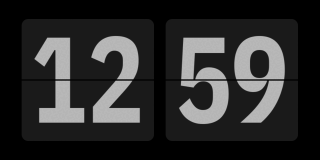
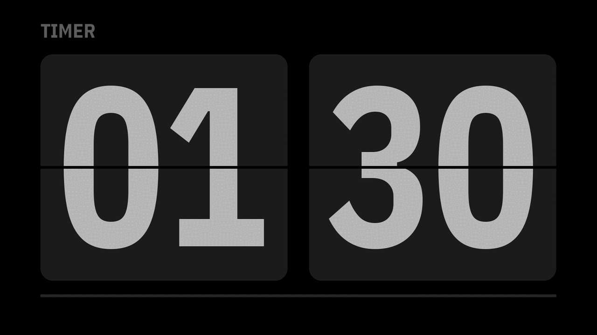
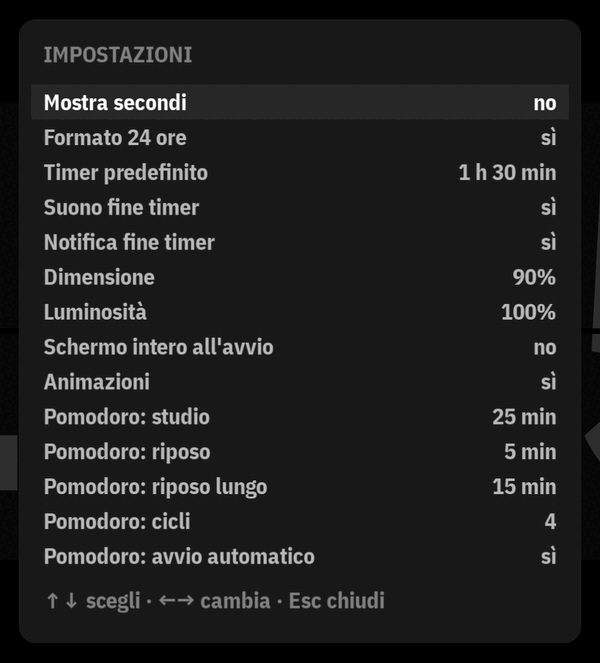
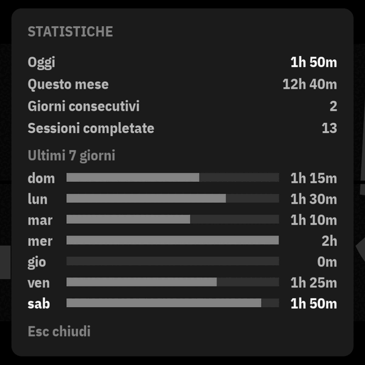

<h1 align="center">Ribalta</h1>

<p align="center">
  <b>A tiny flip clock and study timer for Linux — ~18 MB of RAM, ~0% CPU when idle.</b>
</p>

<p align="center">
  
  
  
  
</p>

<p align="center">
  
</p>

**Ribalta** is a lightweight flip clock for Linux (Wayland and X11), written in C17 with SDL3 and
SDL3_ttf. It shows the time on animated flip tiles and doubles as a study companion: a countdown
timer that keeps running in the background, a Pomodoro mode, study statistics and a screensaver
mode.

The name is Italian: *ribalta* means "flip over" (as in a tile turning) and also "the stage"
(the limelight). The look is inspired by the classic flip-clock style, but the code and artwork are
original and the project is not affiliated with Fliqlo.

> The interface is currently in Italian (labels such as `TIMER`, `RIPOSO`, `IMPOSTAZIONI`,
> `STATISTICHE`).

## ✨ Features

- 🕰️ **Flip clock** `HH:MM`, with optional seconds and 12h/24h format; only the tiles that change flip
- ⏳ **Study timer** from 0h01 to 23h59, keeps running while you look at the clock
- 🍅 **Pomodoro** with study, short break and long break phases (breaks turn the digits blue)
- 📊 **Study statistics**: today, last 7 days, month, streak, completed sessions
- ⚙️ **Settings overlay** (`S`), changes apply live and are saved to a plain `config.ini`
- 🌙 **Screensaver mode** (`ribalta --screensaver`), easy to hook to `swayidle`
- 💡 **Keeps the screen awake** while a timer or Pomodoro is running (idle-inhibit)
- 🔔 **Desktop notification and chime** when a session or phase ends
- 🔒 **Single instance** and 🖥️ **HiDPI** support, resizable window, fullscreen

## 📸 Screenshots

| | |
|:---:|:---:|
| <br>**Clock**: fullscreen `HH:MM` | <br>**Study timer**: running, with progress bar |
| <br>**Pomodoro**: break phase in blue | <br>**Settings** overlay (`S`) |
| <br>**Statistics** overlay (`I`, sample data) | |

## 📦 Installation

**Dependencies**

- `sdl3` and `sdl3_ttf` (SDL3 ≥ 3.2 and SDL3_ttf ≥ 3.2; build and runtime)
- `libnotify` (optional): provides `notify-send` for desktop notifications

On Arch Linux:

```sh
sudo pacman -S sdl3 sdl3_ttf libnotify
```

On other distributions install the equivalent SDL3 and SDL3_ttf development packages
(`pkg-config` must find `sdl3` and `sdl3-ttf`), plus a C compiler and `make`.

**Build and install**

```sh
git clone https://github.com/Ginteaa/Ribalta.git && cd Ribalta
make            # development build
make release    # optimised build (LTO, stripped)
make install    # installs to ~/.local (runs a release build first)
```

`make install` puts the binary in `~/.local/bin/ribalta`, the launcher in
`~/.local/share/applications/ribalta.desktop` and the assets (font, licence, chime) in
`~/.local/share/ribalta`. Use `PREFIX=/usr make install` (as root) for a system-wide install, and
`make uninstall` (with the same `PREFIX`) to remove everything. Make sure `~/.local/bin` is in
your `PATH`.

## ⌨️ Keyboard shortcuts

| Key | Action |
|---|---|
| `F` / `F11` / double click | Toggle fullscreen |
| `T` | Toggle Clock / Timer view (a running timer continues in the background) |
| `P` | Toggle Clock / Pomodoro view (`T` and `P` also switch directly between the two) |
| `Space` / `Enter` | Timer or Pomodoro: start / pause / resume |
| `R` | Timer: reset to the set duration. Pomodoro: reset everything |
| `N` | Pomodoro: skip to the next phase |
| `I` | Open / close the statistics panel |
| `← →` / `↑ ↓` | Timer in setup: select hours or minutes / adjust them (hours ±1, minutes ±1, `Shift` = ±10 min). Panels: navigate and change values |
| `S` | Open / close the settings panel |
| `Esc` | Close the panel; otherwise leave fullscreen |
| `Q` / `Ctrl+Q` | Quit |

`ribalta --help` lists the command-line options.

## ⚙️ Configuration

Settings live in `~/.config/ribalta/config.ini` (honours `$XDG_CONFIG_HOME`), in `key=value`
format; unknown keys are ignored and invalid values fall back to the default. You normally never
edit it by hand: the settings panel (`S`) changes everything live and saves on close.

| Key | Default | Description |
|---|---|---|
| `show_seconds` | `false` | Show seconds |
| `clock_24h` | `true` | 24h format (`false` = 12h with AM/PM) |
| `timer_default_minutes` | `60` | Proposed timer duration (1–1439) |
| `timer_sound` | `true` | Play a chime when the timer ends |
| `timer_notify` | `true` | Desktop notification when the timer ends |
| `scale` | `90` | Tile width in % of the window (50–100) |
| `brightness` | `100` | Digit brightness (20–100), handy at night |
| `start_fullscreen` | `false` | Start fullscreen |
| `animations` | `true` | Flip animation |
| `pomodoro_work` | `25` | Study minutes (1–180) |
| `pomodoro_break` | `5` | Short break minutes (1–60) |
| `pomodoro_long_break` | `15` | Long break minutes (1–120) |
| `pomodoro_cycles` | `4` | Study sessions before the long break (1–12) |
| `pomodoro_auto_continue` | `true` | Start the next phase automatically |

## 🍅 Pomodoro

`P` opens the Pomodoro view: STUDIO (25 min) → RIPOSO (5 min) → … and, after 4 study sessions, a
RIPOSO LUNGO (15 min), then the cycle restarts. `Space`/`Enter` starts or pauses, `N` skips to
the next phase, `R` resets. During breaks the digits turn blue. At the end of each phase you get a
notification and a chime, and with `pomodoro_auto_continue=true` the next phase starts by itself.
The timer and the Pomodoro are independent and can both run in the background.

## 📊 Statistics

Study sessions (timer sessions and Pomodoro study phases, never breaks, and only if at least 60 s
were studied) are appended to `~/.local/share/ribalta/sessions.csv` (honours `$XDG_DATA_HOME`),
one row per session:

```csv
inizio,durata_s,tipo,completata
2026-11-14T09:30:00,1500,pomodoro,1
```

The columns are the local start time (ISO 8601), the studied seconds (pauses excluded), the type
(`timer` or `pomodoro`) and whether the session ran to completion (`1`) or was stopped early (`0`).
Press `I` to see today, the last 7 days, the month, your streak of consecutive days and the number
of completed sessions. The file is read only when the panel opens.

## 🌙 Screensaver

```sh
ribalta --screensaver
```

Fullscreen with a hidden cursor; any key, click or mouse movement exits (events in the first second
are ignored). It saves nothing, and if Ribalta is already running the screensaver instance exits
immediately. To start it after 5 minutes of inactivity, for example with niri
(`~/.config/niri/config.kdl`):

```kdl
spawn-at-startup "swayidle" "-w" "timeout" "300" "ribalta --screensaver"
```

or from any compositor/session script:

```sh
swayidle -w timeout 300 'ribalta --screensaver'
```

## ⚡ Performance

Measured on Wayland (niri) with the default `gpu` renderer and the window visible:

| Metric | Value |
|---|---|
| Memory (PSS) at idle | ~17–19 MB |
| CPU, `HH:MM` clock (one flip per minute) | ~40 ms per minute (~0.07%) |
| CPU while seconds are visible | ~2.2% |
| CPU when the window is not in view | ~0.15%, even with seconds |
| Flip animation | 30 fps, 400 ms |
| Release binary size | ~60 KB |

Tips for the absolute minimum: set `show_seconds=false` and/or `animations=false`. The renderer
is tried in the order `gpu, opengl, opengles2, software`; override it with
`SDL_RENDER_DRIVER=<name> ribalta` (the OpenGL renderer uses noticeably more memory).

## 🛠️ How it works

- **Event-driven loop**: when nothing animates, the process sleeps in `SDL_WaitEventTimeout` until
  the next minute (or second) boundary or an input event. No fixed-rate polling.
- **Pre-rendered glyph textures**: digits and tiles are rasterised once with SDL3_ttf (and again
  only on resize); a flip just composites rectangles already on the GPU.
- **Faces re-rendered only on change**: a frame is drawn only when a value changes, an animation
  runs or a panel opens.
- **Monotonic timer**: timers store their end instant from a monotonic clock, so system time
  changes and NTP adjustments do not affect them.
- **Load on demand**: the font and the audio are loaded only when needed (for example while a
  panel is open or a chime plays), and notifications use `notify-send` instead of linking libnotify.

## 📚 Documentation

The design documents live in [`docs/`](docs/README.md):

- [Functional specification](docs/01-functional-spec.md): modes, settings, controls, requirements
- [Visual design](docs/02-visual-design.md): palette, geometry, flip animation, mockups
- [Architecture](docs/03-architecture.md): stack, performance strategy, modules, development workflow
- [Roadmap](docs/04-roadmap.md): development phases and future ideas

## 🙏 Credits

- **IBM Plex Sans Condensed** font, licensed under the SIL Open Font License 1.1
  (see [`assets/OFL.txt`](assets/OFL.txt))
- [SDL3](https://libsdl.org) and SDL3_ttf for windowing, rendering, input and audio
- The chime sound (`assets/ding.wav`) was generated for this project

## 📄 License

The license for the Ribalta source code has not been chosen yet. The bundled IBM Plex Sans
Condensed font is distributed under the SIL Open Font License 1.1.
